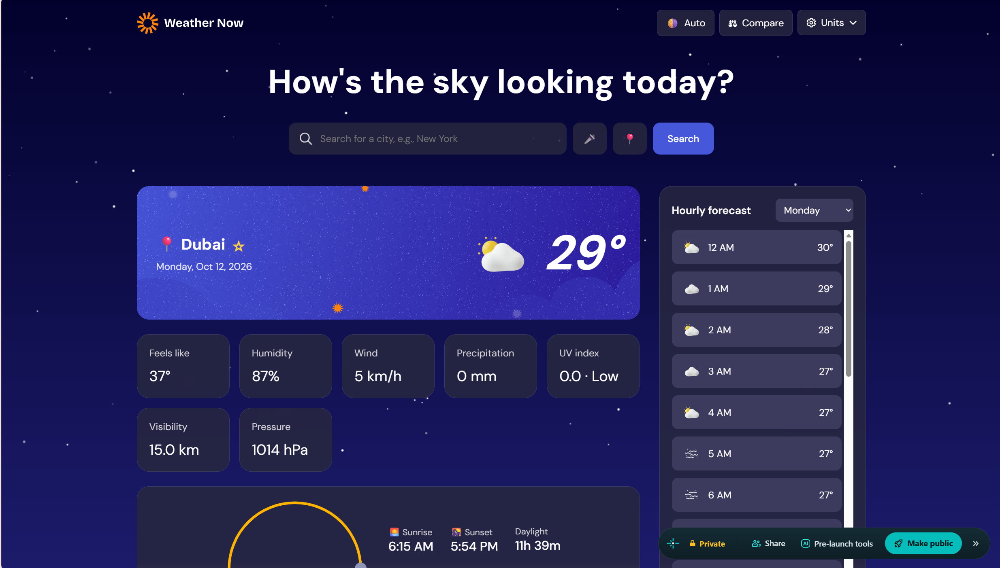

# Frontend Mentor - Weather app solution

This is a solution to the [Weather app challenge on Frontend Mentor](https://www.frontendmentor.io/challenges/weather-app-K1FhddVm49). Frontend Mentor challenges help you improve your coding skills by building realistic projects.

## Table of contents

- [Overview](#overview)
  - [The challenge](#the-challenge)
  - [Extra features](#extra-features)
  - [Screenshot](#screenshot)
- [My process](#my-process)
  - [Built with](#built-with)
  - [What I learned](#what-i-learned)
  - [Continued development](#continued-development)
  - [Useful resources](#useful-resources)
- [Author](#author)

## Overview

### The challenge

Users should be able to:

- Search for weather information by entering a location in the search bar
- View current weather conditions including temperature, weather icon, and location details
- See additional weather metrics like "feels like" temperature, humidity percentage, wind speed, and precipitation amounts
- Browse a 7-day weather forecast with daily high/low temperatures and weather icons
- View an hourly forecast showing temperature changes throughout the day
- Switch between different days of the week using the day selector in the hourly forecast section
- Toggle between Imperial and Metric measurement units via the units dropdown
- Switch between specific units for temperature (Celsius/Fahrenheit), wind speed (km/h, mph) and precipitation (mm, in)
- View the optimal layout for the interface depending on their device's screen size
- See hover and focus states for all interactive elements on the page

### Extra features

Beyond the brief, I added:

- **Geolocation:** shows weather for the user's current location on first visit (falls back to Berlin if denied)
- **Saved locations:** bookmark favorite places and switch between them with one click
- **Compare locations:** view current conditions for up to 4 places side by side
- **More data:** UV index, visibility and air pressure
- **Sunrise/sunset:** an arc showing the sun's position, plus daylight length
- **Animated backgrounds:** rain, storm, snow, clouds, stars and sun glow based on current conditions
- **Voice search:** search by speaking, in browsers that support the Web Speech API
- **Adaptive theme:** light/dark switches automatically by day or night at the searched location, with a manual override
- **PWA:** installable, with the app shell cached for offline use

### Screenshot



## My process

### Built with

- Semantic HTML5 markup
- CSS custom properties (theming)
- Flexbox and CSS Grid
- Responsive, mobile-friendly layout
- Vanilla JavaScript (no framework)
- [Open-Meteo API](https://open-meteo.com/) - forecast and geocoding, no API key needed
- Canvas API - animated weather backgrounds
- Web Speech API - voice search
- Geolocation API
- Service Worker + Web App Manifest - PWA

### What I learned

**Working with a real API.** Open-Meteo returns parallel arrays (`hourly.time`, `hourly.temperature_2m`, and so on), so I match values to a time by index. For example, UV index and visibility are hourly values, so I find the index of the current hour:

```js
const i = Math.max(0, h.time.indexOf(c.time.slice(0, 13) + ":00"));
const uv = h.uv_index[i], vis = h.visibility[i];
```

**Fetching several locations in one request.** Open-Meteo accepts comma-separated coordinates and returns an array, which keeps the compare view to a single network call. A single location returns an object, so I normalise the response first:

```js
let j = await r.json();
j = Array.isArray(j) ? j : [j];
```

**Drawing progress along an SVG path.** Setting `pathLength="1"` on the sunrise arc means a dash length of `0.6` is exactly 60% of the arc, so the daylight progress is a single number:

```html
<path d="M20 90A100 100 0 0 1 220 90" pathLength="1" stroke-dasharray="0.6 1" />
```

**Theming with CSS variables.** Colours live in custom properties on `:root`. A `data-theme` attribute swaps the palette, and JavaScript sets the background gradient per weather condition.

**Also:** debouncing search suggestions, handling loading, error and empty states, and keeping geolocation, the service worker and PWA install in mind (they need HTTPS or localhost).

### Continued development

- Cache the last successful forecast so the app shows data when offline
- Proper PNG icons (192px/512px) for better PWA install support
- Reverse geocoding to show a precise place name for detected locations
- Unit tests for the data-formatting helpers
- Further accessibility work (live regions for loading and errors, keyboard navigation in suggestions)

### Useful resources

- [Open-Meteo docs](https://open-meteo.com/en/docs) - parameters for forecast data
- [Open-Meteo geocoding API](https://open-meteo.com/en/docs/geocoding-api) - city search
- [MDN: Progressive web apps](https://developer.mozilla.org/en-US/docs/Web/Progressive_web_apps) - manifest and service workers

## Author

- Website - [Afreen](https://weather-app-bc6822.netlify.app)
- Frontend Mentor - [@reenfr](https://www.frontendmentor.io/profile/reenfr)
- GitHub - [@yourusername](https://github.com/yourusername)